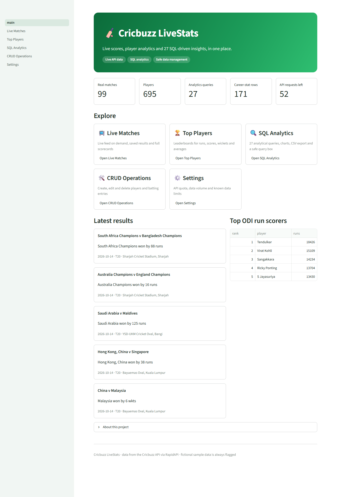
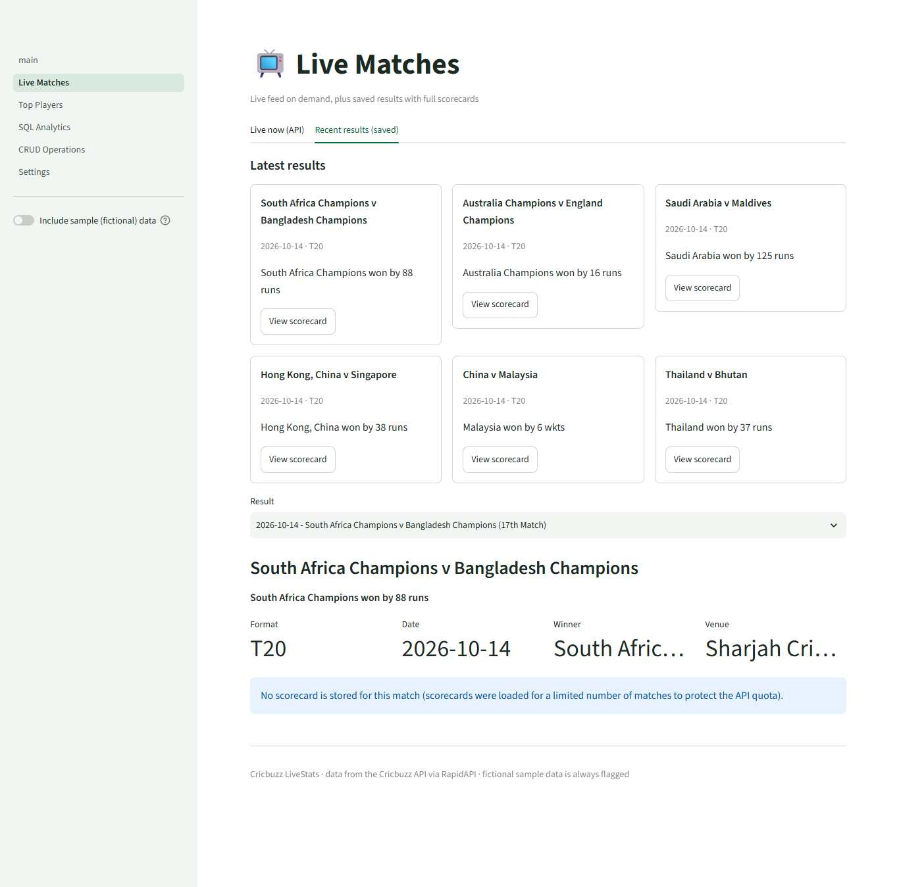
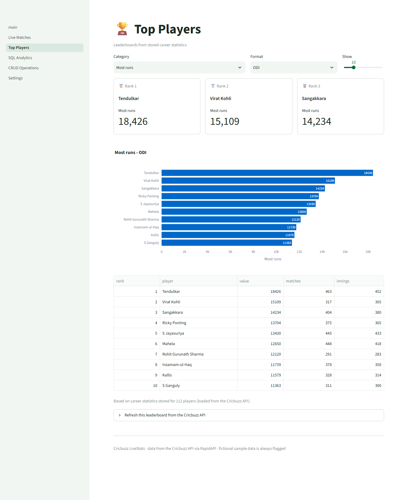
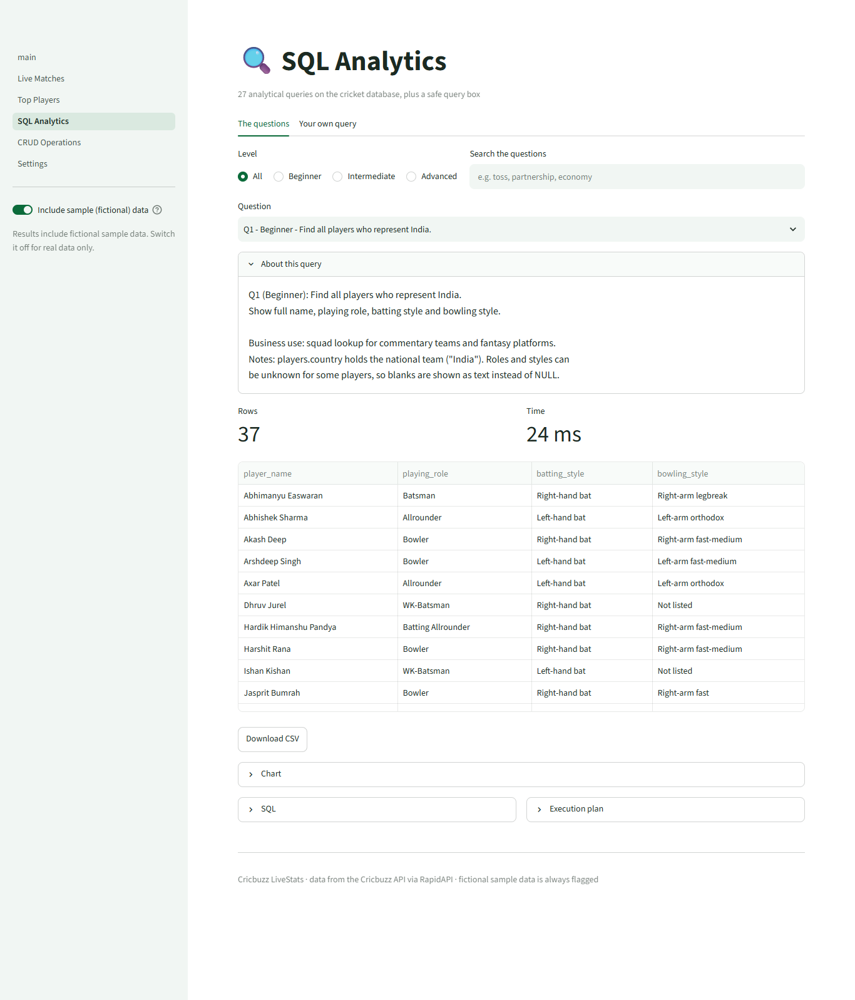
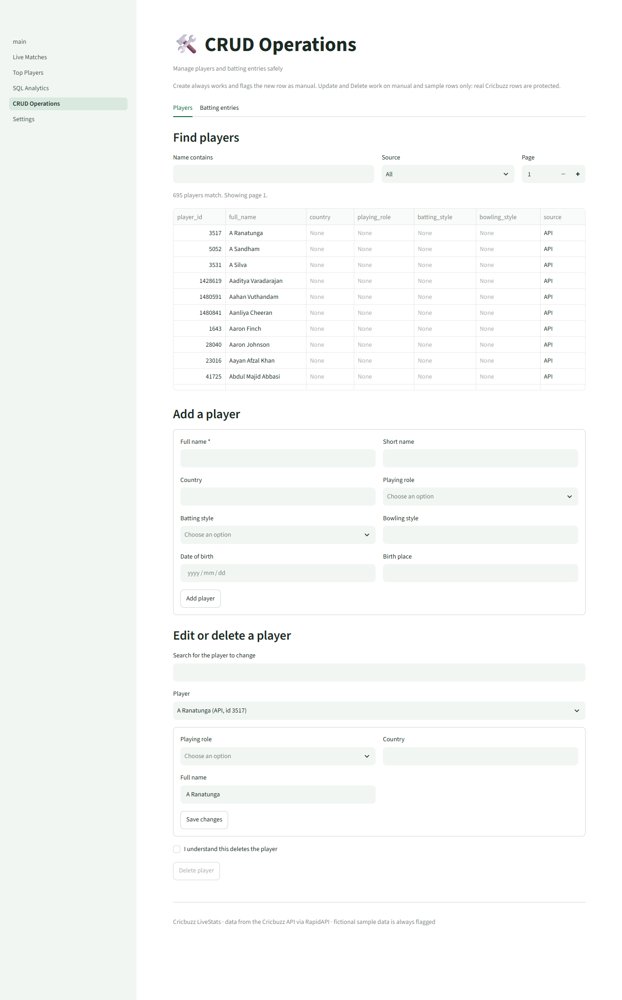
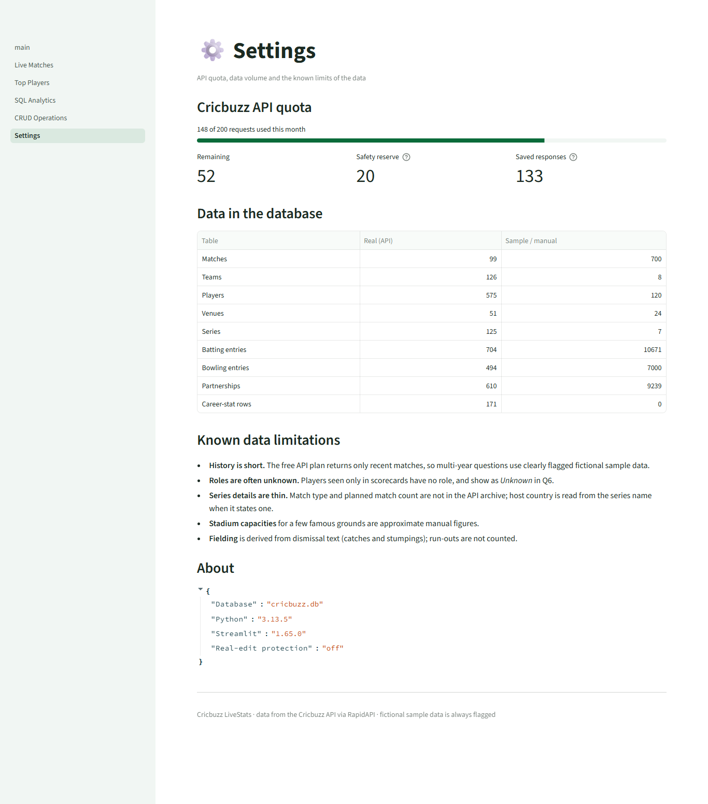

# 🏏 Cricbuzz LiveStats

**Real-time cricket insights and SQL-based analytics**: a Streamlit dashboard that
combines live data from the Cricbuzz API with a SQL database, 25 analytical SQL
questions, a safe read-only query box and hands-on data management.



## Features

| Page | What it does |
|---|---|
| **Home** | Project overview, navigation, real vs sample data counts |
| **Live Matches** | Live feed on demand (cached), saved recent results, full scorecards |
| **Top Players** | Leaderboards for runs, scores, wickets, averages and more, with charts |
| **SQL Analytics** | 25 questions (27 queries) with SQL, execution plans, charts and CSV export; a **read-only custom SQL box**; an **"include sample data" switch** |
| **CRUD Operations** | Create, read, update and delete players and batting entries, with validation |
| **Settings** | API quota meter, data volume, known data limitations |

## Screenshots

| | |
|---|---|
|  |  |
| **Home**: key numbers, shortcuts, latest results | **Live Matches**: result cards and scorecards |
|  |  |
| **Top Players**: podium, chart, table | **SQL Analytics**: 27 queries, filters, charts, CSV |
|  |  |
| **CRUD Operations**: safe data management | **Settings**: API quota, data volume, limits |

## Quick start (Windows PowerShell)

Requirements: Python 3.10 or newer, Git.

```powershell
git clone <your-repository-url>
cd cricbuzz-livestats
python -m venv venv
venv\Scripts\activate
pip install -r requirements.txt
copy .env.example .env          # then open .env and add your key (see below)
python -m database.init_db
python -m data.ingest --fixtures      # real saved API samples, 0 API calls
python -m data.seed_sample_data       # clearly flagged fictional history
python -m data.enrich                 # stadium capacities, series details
streamlit run main.py
```

No API key and no time? Set `AUTO_SETUP=1` (environment variable) and just run
`streamlit run main.py`: the app builds a demo database on its first start.

### API key configuration

1. Subscribe to **Cricbuzz Cricket** on RapidAPI (the free *Basic* plan gives 200 requests a month).
2. Put the key in `.env` (never commit this file; it is in `.gitignore`):
   ```
   RAPIDAPI_KEY=your_key_here
   RAPIDAPI_HOST=cricbuzz-cricket.p.rapidapi.com
   DB_PATH=data/cricbuzz.db
   API_CALLS_OFFSET=14          # requests already used (dashboard % x 200)
   ```
3. Load real data safely. Every command is a **dry run** until you add `--confirm`:
   ```powershell
   python -m data.ingest --live recent                 # shows the plan and its cost
   python -m data.ingest --live recent --confirm       # 1 request
   python -m data.ingest --live scorecards --limit 10 --confirm
   ```
   Other steps: `series`, `info`, `venues`, `players`, `top-batters`, `records`, `team-players`.
   Responses are saved in `data/raw/`; a repeat costs nothing, and
   `python -m data.reload_cache` rebuilds the database from them with 0 requests.

## How the data is organised

- **Real data** comes from the Cricbuzz API: matches, scorecards, players, career stats,
  leaderboards, squads.
- **Sample data** is generated by `data.seed_sample_data`: fictional teams ("Sample XI ...")
  playing 700 matches ball by ball, so questions about *years* of history have something to
  analyse. Every sample row has `is_sample = 1` and the Analytics page can hide it.
  Nothing generated ever uses a real team or player name.
- Manually entered rows (stadium capacities, CRUD entries) are flagged the same way.

## The questions

All 25 questions (plus companions `22b` and `25b`) are in `sql/queries/`, one file each,
with the question, assumptions and caveats in the header. See
[documentation/QUERIES.md](documentation/QUERIES.md). Run one from the terminal:

```powershell
python -m services.query_runner 7 --plan      # one query with its execution plan
python -m services.query_runner --all         # every query, rows and timing
```

## Project structure

```
main.py                  entry point (navigation)     views/home.py   Home page
pages/                   Live Matches, Top Players, SQL Analytics, CRUD, Settings
api/                     client (cache, budget guard), parsers, endpoint templates
services/                logic behind each page (no SQL in the pages)
database/                schema.sql, views.sql, repositories, init script
sql/queries/             the 27 analytics queries
data/                    ingestion, sample data, enrichment, snapshot tool
utils/                   db_connection, validators, logger, bootstrap, UI helpers
tests/                   automated tests and saved real API samples (fixtures/)
documentation/           architecture, database, API mapping, queries, testing, deployment
```

Details: [ARCHITECTURE](documentation/ARCHITECTURE.md) ·
[DATABASE](documentation/DATABASE.md) · [API mapping](documentation/API_MAPPING.md) ·
[TESTING](documentation/TESTING.md) · [DEPLOYMENT](documentation/DEPLOYMENT.md)

## Testing

```powershell
python -m pytest -q                         # all tests
python -m pytest -q tests/test_queries.py   # just the queries (fast)
black . ; flake8 .                          # style (PEP 8)
```

The tests run against real saved API responses and against hand-made data with
boundary cases, and every page is loaded headlessly with Streamlit's `AppTest`.

## Deployment

See [documentation/DEPLOYMENT.md](documentation/DEPLOYMENT.md): Streamlit Community Cloud
(recommended), Docker, Render/Railway, Azure/AWS. A hosted app needs the database: commit
a snapshot with `python -m data.make_snapshot` and set `AUTO_SETUP=1`.

## Known limitations

- The free API plan returns only recent matches, so history questions rely on flagged sample data.
- Many players seen only in scorecards have no role (shown as *Unknown* in Q6).
- Series match type and planned match counts are not in the API archive.
- Stadium capacities for a few famous grounds are approximate manual figures.
- Fielding comes from dismissal text; run-outs are not counted.
- On a hosted app, CRUD changes disappear when the app restarts.

## Future improvements

- A paid API plan or a second source for multi-year history, replacing the sample data.
- Scheduled refresh jobs and live auto-updating scorecards.
- PostgreSQL for several simultaneous editors; user accounts and roles.
- Match prediction models using the head-to-head and form queries.
- More CRUD forms (bowling entries, matches) and an audit log of edits.

## Credits

Cricket data: Cricbuzz via RapidAPI. Built for learning; not affiliated with Cricbuzz.
